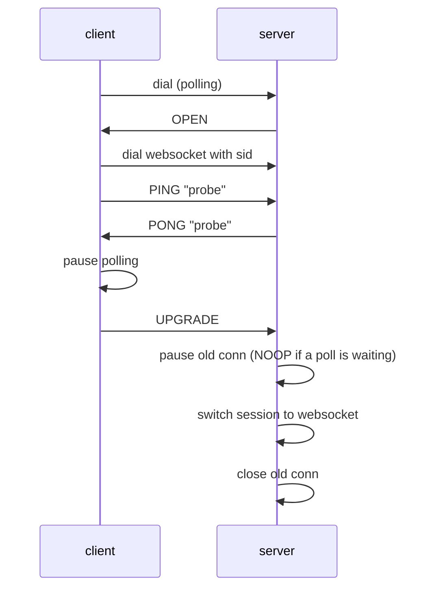

# Protocol support

This file owns the protocol facts: what the current code implements, known deviations,
and the deltas planned for v2. Client version compatibility is summarised in
[README.md](../README.md#compatibility).

## Implemented: Engine.IO protocol v3

Package `v2/engineio`, the v2 module. The root `engineio` package of the v1 module is
described in [its own section](#implemented-engineio-protocol-v3-in-the-v1-module).

- Query parameter `EIO` is not checked; the server behaves as protocol v3 regardless.
- Transports: `polling` (XHR only; the `j` JSONP parameter and the `b64` parameter are
  ignored, as in Engine.IO v4) and `websocket` (`gobwas/ws`). Order and upgrade path come from `engineio.Options.Transports`,
  default `[polling, websocket]`.
- Handshake (`OPEN` packet) carries `sid`, `upgrades`, `pingInterval` (default 20 s),
  `pingTimeout` (default 60 s). There is no `maxPayload`.
- Heartbeat: the client sends `PING` (`2`), the server answers `PONG` (`3`) and extends
  the read/write deadline by `pingTimeout`.
- Polling payload (Engine.IO v4 framing, ahead of the rest of this section): packets are
  separated by the record separator `0x1e`; binary packets are base64 behind a `b`
  prefix; every body is `text/plain; charset=UTF-8`, and a POST of `application/octet-stream`
  is HTTP 400. A POST body is read up to the transport's `MaxPayload` (default 1 MiB,
  `polling.Transport.MaxPayload`) before it is decoded: an announced or actual size over it is
  HTTP 413 and delivers nothing; a malformed body is HTTP 400, delivers nothing and ends
  the session. The server does not limit its responses: a response carries every packet the
  session writers hand over at once. The Go client reads a response (and the open
  response) up to the same `MaxPayload`; a longer one fails the session with
  `payload.ErrTooLarge`, which readers see. The client batches its POSTs up to the
  `maxPayload` of the open packet, and up to its `MaxPayload` (default 1 MiB) while the
  open packet carries none, as this server's does today. Sessions are looked up by `sid`; an unknown `sid` is HTTP 400.
  The handshake, heartbeat and `EIO` check of this section are still v3 until the
  rest of 2.1 lands; the heading of this section flips with that change.
- WebSocket framing (Engine.IO v4, ahead of the rest of this section): one packet per data
  message. A text message is the type byte and the data; a binary message is the raw data of
  a MESSAGE packet with no type byte, and the text form `b` + base64 is read as a binary
  MESSAGE. The server hijacks the HTTP/1.1 request (`ws.UpgradeHTTP`); a response writer
  that is not an `http.Hijacker`, as with HTTP/2, is answered with HTTP 501 and logged as
  `engineio: request rejected` with `reason="no hijacker"`. No extension is negotiated, so
  `permessage-deflate` is not supported, and no subprotocol is selected by the server. A
  message is limited to the transport's `MaxPayload` (default 1 MiB,
  `websocket.Transport.MaxPayload`), the fragments of one message together, checked before
  they are buffered. The peer is told why it is cut off with a close frame, then the TCP
  connection is half-closed, drained for at most one second and closed (a `Close` by the consumer in between marks the connection closed but leaves the socket to the drain): status 1009 for an oversized message, 1007 for invalid UTF-8 and
  1002 for a framing violation (unmasked client frame, reserved bits or opcode, a stray
  continuation) or an invalid Engine.IO packet (empty text, unknown type byte, malformed
  base64). A received close frame is answered with its status and closes the connection. Ping
  and pong control frames, also between fragments, are answered by the transport and are
  not Engine.IO packets. A handshake rejected by the origin check (`CheckOrigin`, by default
  same origin) is HTTP 403. The WebSocket `Proxy` hook supports `http` proxies through
  CONNECT only.
- Upgrade polling → websocket:

  Implemented in `session.Session.upgrading`. If the client never sends `UPGRADE`, the
  paused polling connection is resumed.
- Error responses are plain text with HTTP 400 (bad transport, bad sid) or 502
  (request checker or transport accept failure).

## Implemented: Engine.IO protocol v3 in the v1 module

Package `engineio` of the v1 module at the repository root.

- Query parameter `EIO` is not checked; the server behaves as protocol v3 regardless.
- Transports: `polling` (XHR only; JSONP is removed and the `j` query parameter is
  ignored) and `websocket` (`gorilla/websocket`). Order and upgrade path come from `engineio.WithTransports`,
  default `[polling, websocket]`.
- Handshake: a GET without `sid` opens a session (any other method is answered HTTP 400
  with code 2, below). The `OPEN` packet carries `sid` (random, as engine.io's
  `base64id`), `upgrades` (`[]` with `WithUpgrades(false)`), `pingInterval` (default
  25 s) and `pingTimeout` (default 20 s). There is no `maxPayload`: protocol v3 has none.
- Heartbeat: the client sends `PING` (`2`), the server answers `PONG` (`3`). Every packet
  the session reads re-arms a window of `pingInterval + pingTimeout`; when it passes
  without one, the session closes with reason `ping timeout`.
- Polling payload: with `b64=1` packets are length-prefixed (`<length>:<packet>`),
  lengths count UTF-16 code units, and binary packets are base64 with a `b` prefix.
  Otherwise the payload is binary: per packet a `0` (string) or `1` (binary) byte, the
  length as one byte per decimal digit, `0xff`, then the packet, the length counting
  bytes (UTF-8 for a string packet), as engine.io-parser 2.x. Sessions are looked up
  by `sid`; an unknown `sid` is HTTP 400. Server GET responses coalesce complete
  packets for up to 1 ms idle or 5 ms total, at most 64 packets or 256 KiB checked
  between packets. A single packet can exceed that batching byte budget. A change
  in compression preference starts the next response; cancellation fails the transport.
- WebSocket: one packet per message; a binary message starts with the packet type byte.
  The optional permessage-deflate extension is off by default, with a 1024-byte
  encoded-packet threshold when enabled. The Go client offers it when configured,
  with the same threshold. Per-packet compression defaults to true; false suppresses
  it for the packet and all its binary attachments on either transport.
- Polling HTTP compression is enabled by default: gzip or zlib deflate according
  to Accept-Encoding, gzip preferred at equal quality, above the 1024-byte response
  threshold and only for a packet whose compression flag is true. The threshold is
  configurable; responses below it remain uncompressed. A batch shares one compression
  stream and contains only packets with the same compression preference.
- The polling transport that opens a session sets its session cookie on every
  response (default io, Path=/, HttpOnly, SameSite=Strict). The cookie's attributes
  and name are configurable, and it can be disabled. A websocket-first handshake
  sets no cookie, matching engine.io 3.6.2.
- Message limit: `WithMaxHTTPBufferSize`, default 1e6 bytes. A longer polling POST
  body is answered HTTP 413 (plain text) and closes the session; a longer websocket
  message closes the connection with close code 1009. With permessage-deflate, the
  same limit applies to inflated bytes; rejection does not buffer the full message.
- The Go client limits incoming websocket messages (inflated bytes) and whole decoded
  polling response bodies, OPEN included, to 1 MiB by default. The configurable
  limit also applies to reconnects and candidate upgrade transports before probe I/O.
- Duplicate websocket requests carrying a live websocket session ID receive HTTP
  400/code 3. This immediate rejection is Go-specific; the Node reference does not
  use that response for this case.
- Upgrade polling → websocket: the client's `2probe` over the websocket is answered
  `3probe`. Until the client's `UPGRADE` (`5`), POSTs are accepted and their packets
  delivered, and a pending poll is answered with data or, at a 100 ms check, a NOOP;
  the polling connection is paused only on `5`, then the session switches to the
  websocket and closes the polling connection. A failed probe, or one without `5`
  within `WithUpgradeTimeout`, closes the probe connection and leaves polling
  unpaused. Implemented in the private server session upgrade state machine (`engineio/internal/session/upgrade.go`).
- Requests the server rejects before a transport handles them are answered with JSON
  `{"code":<n>,"message":"<text>"}`, as engine.io 3.6.2 answers a request that is not a
  websocket upgrade: HTTP 400 with code 0 `Transport unknown`, 1 `Session ID unknown`, 2
  `Bad handshake method` or 3 `Bad request` (also a transport that cannot accept the
  request, except a websocket handshake that gorilla/websocket answers itself, and a
  session that cannot be created), and HTTP 403 with code 4 and the fixed message
  `Forbidden` when `WithRequestChecker` rejects the request (3.6.2 sends the error
  of `allowRequest` as the message). A websocket upgrade request gets the same
  answers, where engine.io 3.6.2 writes a plain-text HTTP 400 and closes the socket. What
  the polling transport rejects itself stays plain text: HTTP 400 for an unsupported
  `Content-Type`, a POST the payload cannot take (paused, overlapping, closed, timed out
  or not decodable) or an invalid method, 413 for the message limit above, 500 for a poll
  whose response failed before it was started.

## Implemented: Socket.IO protocol v4

The v1 module at the repository root: the `socketio` package and `parser` (`parser.Buffer`,
`Header.Query`). It runs over the root `engineio` package of the previous section. The
v2 module in `v2/` has no
Socket.IO v4 code: its `v2/parser` holds the v5 codec of the next section.

- Packet format `<type>[<attachments>-][<namespace>,][<ack id>][JSON]`. Types
  0 CONNECT, 1 DISCONNECT, 2 EVENT, 3 ACK, 4 ERROR, 5 BINARY_EVENT, 6 BINARY_ACK.
- On a new session the server connects the client to the root namespace `/`
  automatically and sends `0` before any client packet. Other namespaces are joined
  when the client sends `0/<nsp>`.
- A CONNECT to a namespace without a registered handler is answered with an ERROR packet
  (`4/<nsp>,"Invalid namespace"`) and the connection stays open.
- Binary attachments are replaced by `{"_placeholder":true,"num":N}` and sent as
  following binary frames; on the Go side they map to `parser.Buffer`.
- Event handlers return values become the ACK payload; an ACK packet is sent when the
  client requested an ack and a listener handled the event. Emitting with a trailing
  function argument registers an ack callback.
- Namespace query strings (`0/nsp?x=1`) are parsed into `Header.Query` and merged into
  `Handshake().Query` of that socket.

## Known deviations from the v3/v4 specs

Engine.IO, `v2/engineio`:

- No `maxPayload` handshake field is sent yet (the client reads it when present), and
  the websocket message limit is the transport's default 1 MiB, not the advertised value. The
  polling POST limit and the websocket limit are above.

### Redis cluster interoperability

The v1 Redis adapter speaks the broadcast and request protocol of
`socket.io-redis` 5.4.0 with `socket.io` 2.5.0: MessagePack event envelopes with
binary values, room unions, socket exclusions and delivery flags; JSON cluster
queries and remote join/leave/disconnect/custom requests. Go and Node instances
can share a standalone Redis Pub/Sub cluster. Mixed-peer namespace names must be
preserved by Node's URL-path parsing and must not contain `#`. Node 2.5 CONNECT
parsing strips URL fragments, and Node Redis 5.4.0 prefix-matches request channels:
a request for `/cluster#other` can execute against `/cluster`. Such names are
unsupported in mixed clusters, including administrative requests; Go cannot fix
routing performed by an unmodified Node peer.

Go-only adapters route requests by exact channel and namespace. Broadcast namespace
identity is checked from the packet independently of channel separators, including
`#`; that broadcast check does not repair Node's request routing. Custom payloads are JSON,
not binary, matching the reference adapter.

Redis Pub/Sub provides no replay during disconnection. Queries are bounded,
non-atomic snapshots; context-aware operations report timeouts and partial results.
The legacy Go JSON adapter wire format is incompatible with this protocol; see the
[v1 migration guide](V1_MIGRATION.md#adapters-and-redis) before upgrading a cluster.
JSONP and Admin UI remain separate deviations below.

### Deviation D4: JSONP unsupported

The v1 Engine.IO transport supports XHR polling and websocket, without JSONP.
The `j` query parameter is ignored and the response is an ordinary polling
payload, not a JavaScript callback. A JSONP form POST (`d=`) is rejected with
HTTP 400. Clients must use XHR polling or websocket.

### Deviation D19: Admin UI not in v1

The official `@socket.io/admin-ui` requires Socket.IO protocol v5 over Engine.IO v4.
The v1 module implements Socket.IO v4 over Engine.IO v3 and cannot host it. The
planned integration belongs to v2 Stage 5 (`v2/contrib/admin`).

## Implemented in `v2/`: Socket.IO protocol v5 wire codec

Package `v2/parser`, stage 2.3P. It converts packets to and from the wire format and has
no runtime: nothing in the `v2/` root package calls it before stage 2.3S. The wire format is
that of `socket.io-parser` 4.2.7 (protocol 5), checked against it by the Node oracle in
`v2/parser/testdata/oracle` (run by hand, see its README; CI does not run it).

- A message is one text frame, the envelope, followed by as many binary frames as the
  envelope announces. The envelope is `<type>[<attachments>-][<namespace>,][<ack id>][JSON]`.
  Types on the wire: 0 CONNECT, 1 DISCONNECT, 2 EVENT, 3 ACK, 4 CONNECT_ERROR,
  5 BINARY_EVENT, 6 BINARY_ACK. `parser.Type` holds 0 to 4 only; an EVENT or ACK with
  attachments is written as 5 or 6.
- Binary values are replaced in the JSON by `{"_placeholder":true,"num":N}` and sent as
  the following binary frames, in order.

Deliberate differences from the Node.js parser:

- Missing EVENT, ACK or CONNECT_ERROR data is rejected, although Node's decoder
  accepts an absent payload. CONNECT may omit data; DISCONNECT must omit it.
- A namespace in a header must start with `/` and end its header with a comma, and
  contains no comma, NUL, CR or LF. The default namespace is returned as `/`.
- Attachment counts are unsigned decimal digits and positive; `1.0` and `1e0` are
  rejected, and so is a count of zero, as by 4.2.7.
- An acknowledgement ID above 2^53-1 is rejected. Leading zeros are accepted and
  written canonically.
- A placeholder index must be an integer name of an attachment; a fractional index
  is rejected where Node yields an undefined attachment value.
- Envelopes must be valid UTF-8 and valid JSON of bounded depth. The attachment
  count, byte and depth limits are checked here; Node's decoder waits for missing
  attachments instead of failing, so the `Assembler` adds a deadline.
- Unreferenced attachments and repeated placeholder indices are accepted, as by
  Node; each decoded reference owns its bytes where Node shares one buffer. Because
  that multiplies memory, `JSON[T]` decoding counts every reference, repeated ones
  included, against `Limits.MaxEventBytes` and returns `ErrTooLarge` past it.
- JSON decoding replaces an unpaired UTF-16 surrogate escape in a string by U+FFFD
  when a value is decoded into a Go string; the raw `Packet.Data` keeps the escape.

## Planned: Engine.IO v4 and Socket.IO v5

Target of [ROADMAP.md](ROADMAP.md#stage-2-socketio-protocol-v5-over-engineio-protocol-v4-tag-v200).

Engine.IO v3 → v4:

| Area | v3 (current) | v4 (target) |
| --- | --- | --- |
| Query | `EIO` ignored | `EIO=4` required, otherwise HTTP 400 with JSON error code 5 |
| Handshake | `sid`, `upgrades`, `pingInterval`, `pingTimeout` | plus `maxPayload` |
| Heartbeat | client sends `2`, server answers `3` | server sends `2` every `pingInterval`, client answers `3` within `pingTimeout` |
| WebSocket | one packet per frame, binary frames start with a type byte | unchanged; binary frames carry raw bytes (done, see above) |
| Upgrade | `2probe` / `3probe` / `5` | unchanged, plus server sends `6` (NOOP) into the pending poll |
| Errors | plain text | JSON `{"code": N, "message": "..."}`, codes 0..5 |

Socket.IO v4 → v5:

| Area | v4 (v1, repository root) | v5 (target; the wire codec is in `v2/parser`, see above) |
| --- | --- | --- |
| Root namespace | server connects `/` automatically | client must send `0`; server replies `0{"sid":"..."}` |
| Socket id | equals the engine `sid` | separate id per (connection, namespace) |
| CONNECT payload | none | optional JSON auth object: `0/admin,{"token":"abc"}` |
| Connection error | type 4 ERROR, string | type 4 CONNECT_ERROR, object `{"message","data"}` |
| DISCONNECT | `1/nsp` | `1/nsp,` |
| Binary attachments | placeholder objects | unchanged |
| Connection state recovery | none | `pid`/`offset` in CONNECT; out of scope, answered without recovery |

Not planned: EIO=3 in v2, WebTransport, permessage-deflate, connection state recovery.
