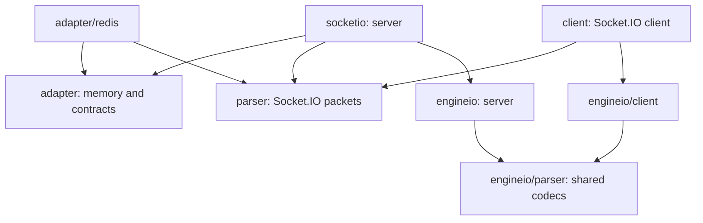

# V1 component migration

The v1 component restructuring changes Go imports and API on `master`. Socket.IO v4
and Engine.IO v3 wire behavior stays the same. This guide covers the completed component extractions and their active entry
points; acceptance and release status are tracked in
[ROADMAP.md](ROADMAP.md#stage-v1-work-packages). V1-to-v2 migration has its own guide.

## Component layout

The public packages follow the Socket.IO / Engine.IO component model. Arrows below
show Go dependencies; a browser client communicates with the server over the wire.
The Go Socket.IO client does not import either server.



| Public component | Private implementation owner |
| --- | --- |
| Root `socketio` server and namespace views | `internal/connection` for transport/socket/queue/ACK/drain; `internal/namespace` for canonical server contracts and registrations |
| `client` constructor/options and client/socket entry points | `client/internal/connection` for manager/generations/reconnect/sockets; `client/internal/namespace` for canonical client contracts, listeners and local rooms |
| `engineio` server | `engineio/internal/session` for accepted session I/O, registry/IDs, heartbeat and upgrade/close |
| `engineio/parser` codec entry points | `engineio/parser/internal/packet` for canonical frame/packet values and codec; `engineio/parser/internal/payload` for streaming payload/framing/leases |
| `adapter`, `adapter/redis`, `parser`, `engineio/client` | Implementation stays within each public component |

`engineio/transport` and its polling/websocket packages supply the transport layer;
`logger` retains the package fallback for components without a per-instance logger.
The complete allowed import graph has 12 public and seven private runtime packages.
[ROADMAP's Component boundaries](ROADMAP.md#stage-v1-work-packages) owns the exact
allowed edges. `make architecture-check` enforces them in CI, along with independent
client/server roles, parser isolation, Redis composition and retired-path removal.
Private exports serve typed boundaries within the library; applications use the
active public names. There is no generic helper package or old import facade.

## Engine.IO codecs and polling

| Old import/API | New import/API |
| --- | --- |
| `engineio/frame.Type`, `String`, `Binary`, `ByteToFrameType` | `engineio/parser.FrameType`, `String`, `Binary`, `ByteToFrameType` |
| `engineio/packet.Type`, packet constants and `ByteToPacketType` | `engineio/parser.PacketType`, the same constants and `ByteToPacketType` |
| `engineio/packet.Encoder`, `Decoder`, `NewEncoder`, `NewDecoder` | `engineio/parser.PacketEncoder`, `PacketDecoder`, `NewPacketEncoder`, `NewPacketDecoder` |
| Packet `FrameReader`, `FrameWriter`, `Frame`, `Packet` and test-fake constructors | Same names in `engineio/parser`, using its frame and packet types |
| `transport.ConnParameters`, `transport.ReadConnParameters` | `engineio/parser.ConnParameters`, `engineio/parser.ReadConnParameters`; `WriteTo` unchanged |
| `engineio/payload.Payload`, `New`, feed/flush/pause/deadline methods | Private polling state; use `polling.Transport` through `transport.Conn` |
| `engineio/payload.Error`, `OpError` | `engineio/transport/polling.Error`, `OpError`; same error text and temporary classification |
| `engineio/transport/utils.Timestamp`, `TimestampFromClock` | Same names in `engineio/transport` |

Transport implementations now use `parser.FrameType` and `parser.PacketType` in their
reader/writer methods. The old import directories are removed without forwarding aliases.
For example, a transport writer accepts these shared wire types:

```go
import (
    "io"

    eioparser "github.com/sshaplygin/go-socket.io/engineio/parser"
)

func writeMessage(conn interface {
    NextWriter(eioparser.FrameType, eioparser.PacketType) (io.WriteCloser, error)
}, body []byte) error {
    w, err := conn.NextWriter(eioparser.String, eioparser.MESSAGE)
    if err != nil {
        return err
    }
    _, err = w.Write(body)
    closeErr := w.Close()
    if err != nil {
        return err
    }
    return closeErr
}
```

For standalone streaming payload codecs, implement `parser.PayloadReader` or
`parser.PayloadWriter` and construct `NewPayloadDecoder(source)` or
`NewPayloadEncoder(sink, WithBinarySupport(supportBinary))`. A source lends a complete payload through
`AcquirePayloadReader() (io.Reader, bool, error)`; the bool selects binary framing.
`ReleasePayloadReader(error) error` receives the decode error, or nil after the last
packet reader is closed. A sink lends a writer for each packet through
`AcquirePayloadWriter() (io.Writer, error)` and receives its completion through
`ReleasePayloadWriter(error) error`. An acquisition error does not trigger release;
a release error takes precedence over the codec error. Close every packet reader/writer
before requesting another. A decoder retains decode/release failures: later calls
return that terminal error without reading or releasing the source again. A non-EOF
body read error releases the source immediately, including a read that returns data
and an error together; normal packet EOF remains successful. Acquisition
failures may be retried because they did not acquire a payload. The codecs own framing; polling owns HTTP requests,
concurrency, deadlines and pause/resume. Use godoc for the complete streaming contract.

## Server and client roles

| Old import/API | Current import/API |
| --- | --- |
| Root `Client`, `NewClient`, `ErrEmptyAddr`, `EmptyAddrErr` | `client.Client`, `client.New`, `client.ErrEmptyAddr` |
| `client.NewClient(addr, *engineio.Options)` | `client.New(addr, ...client.Option)` |
| Root connection type/error aliases | Server types/errors belong to `socketio`; client types/errors belong to `client` |
| `engineio.Dialer`, `engineio.Opener` | `engineio/client.Dialer`, `engineio/client.Opener` |
| `session.ReadyState`, `CloseReason`, `CloseError` | Server contracts in `engineio`; client contracts in `engineio/client` |
| `session.FrameType`, `TEXT`, `BINARY` | Engine frame APIs use `engineio/parser.FrameType`, `String`, `Binary`; Socket.IO codec APIs use `parser.FrameType`, `Text`, `Binary` |
| Public `session.New`/`Session`/`Manager` | Server-owned private session/registry; obtain connections through `engineio.Server.Accept`, inspect them through `Clients`/`Count` |
| `session.IDGenerator`, `DefaultIDGenerator` | Same names in `engineio` |
| `session.Pauser` | `engineio/transport.Pauser` |
| Session hook/limit/request setters | `engineio.WithHooks`, `WithMaxHTTPBufferSize`, `WithUpgradeTimeout`; `WithConnInitor` receives the handshake request and connection |
| Concrete session `Abort` | `engineio.Abort(conn)`; custom engines receive ordinary `Close` |
| Concrete session `Shutdown` | Shutdown belongs to `engineio.Server.Close` |

Use `socketio.Conn` in server handlers and `client.Conn` in client handlers. The same
rule applies to `Namespace`, `Emitter`, `AckFunc` and `Handshake`. Their identities are
independent; callbacks using the other role's `Conn` no longer type-check on typed
registrations and are rejected at event registration. `ErrWriteBufferFull` has a separate
identity in each role: use the error of that role with `errors.Is`. `ErrServerOnly` belongs
to the client. Client `EngineConn` and `Request` still return nil, and `Handshake` still
returns its zero value. Room, ACK, buffering and reconnect behavior stays the same.

Server `engineio.Conn` and client `engineio/client.Conn` have separate state/error types.
Use the matching role's constants and `CloseError` with `errors.As`. Both use common
Engine.IO frame types. Socket.IO parser implementations use their own frame types;
convert explicitly to/from `engineio/parser.FrameType` at a transport boundary. The
library's server and client perform these conversions internally.

## Constructor configuration

Default constructors omit optional configuration: `socketio.NewServer()`,
`engineio.NewServer()` and `client.New(addr)`. Each role exposes its own `Option`
functions. Options apply in order; the last setting wins. Reusing options creates
independent instance configuration. Client headers/query and engine cookie/built-in
transport settings retain their construction-time copies. Callback state and custom
transports remain application-owned.

| Previous configuration | Current option |
| --- | --- |
| `NewServer(*engineio.Options)` or `NewServer(*socketio.Options)` | `socketio.NewServer(...socketio.Option)` |
| Root `Options.Engine` | `socketio.WithEngineOptions(...engineio.Option)` |
| Root queue/drain fields | `socketio.WithWriteBufferSize(n)`, `socketio.WithCloseTimeout(d)` |
| Engine logger also used by Socket.IO | `socketio.WithLogger(log)` configures both layers |
| `engineio.NewServer(*engineio.Options)` | `engineio.NewServer(...engineio.Option)` |
| Engine `PingInterval`, `PingTimeout`, `UpgradeTimeout` | `engineio.WithPingInterval(d)`, `WithPingTimeout(d)`, `WithUpgradeTimeout(d)` |
| Engine `MaxHTTPBufferSize`, `CompressionThreshold` | `engineio.WithMaxHTTPBufferSize(n)`, `WithCompressionThreshold(n)` |
| Engine `DisableUpgrades`, `DisableHTTPCompression`, `DisableCORS` | `engineio.WithUpgrades(!disabled)`, `WithHTTPCompression(!disabled)`, `WithCORS(!disabled)` |
| Engine `Cookie`, `DisableCookie` | `engineio.WithCookie(cookie)`, `WithCookieEnabled(!disabled)` |
| Engine `PerMessageDeflate`, `Transports` | `engineio.WithPerMessageDeflate(enabled)`, `WithTransports(transports...)` |
| Engine `SessionIDGenerator`, `RequestChecker`, `ConnInitor`, `Hooks`, `Logger` | `engineio.WithSessionIDGenerator(gen)`, `WithRequestChecker(check)`, `WithConnInitor(init)`, `WithHooks(hooks)`, `WithLogger(log)` |
| `client.New(addr, *client.Options)` | `client.New(addr, ...client.Option)` |
| Client `Path`, `Query`, `Header`, `Timeout` | `client.WithPath(path)`, `WithQuery(query)`, `WithHeader(header)`, `WithTimeout(timeout)` |
| Client `WriteBufferSize`, `CloseTimeout`, `Logger` | `client.WithWriteBufferSize(n)`, `WithCloseTimeout(d)`, `WithLogger(log)` |
| Client `Transports`, `PerMessageDeflate` | `client.WithTransports(transports...)`, `WithPerMessageDeflate(enabled)` |
| Client `DisableReconnection` | `client.WithReconnection(!disabled)` |
| Client retry attempts/delay/cap/jitter | `client.WithReconnectionAttempts(n)`, `WithReconnectionDelay(d)`, `WithReconnectionDelayMax(d)`, `WithRandomizationFactor(factor)` |
| `transport.NewManager(transports)` | `transport.NewManager(transport.WithTransports(transports...))`; `NewManager()` creates an empty registry |
| `parser.NewPayloadEncoder(writer, supportBinary)` in Engine.IO | `parser.NewPayloadEncoder(writer, parser.WithBinarySupport(supportBinary))`; omitted configuration enables binary payload framing |

The public server/client option structs are removed. Required addresses, codec I/O
and fake-reader input frames remain positional. Codec constructors without optional
configuration keep their required reader/writer arguments.

Engine.IO heartbeat timeout and Socket.IO drain duration remain independent. Move any
old `PingTimeout` used as a drain bound to the Socket.IO role's `WithCloseTimeout`.
Nonpositive queue/drain values still mean 64 packets and one minute. Other existing
zero/negative/default semantics are unchanged; each With function documents them.
Root `WithLogger` configures Socket.IO and its engine. A later
`WithEngineOptions(engineio.WithLogger(other))` overrides only the engine's sink.

```go
server := socketio.NewServer(
    socketio.WithEngineOptions(
        engineio.WithPingInterval(25*time.Second),
        engineio.WithPingTimeout(20*time.Second),
    ),
    socketio.WithWriteBufferSize(64),
    socketio.WithCloseTimeout(time.Minute),
)
server.OnConnect("/", func(c socketio.Conn) error {
    c.Join("lobby")
    return nil
})

cl, err := client.New("http://127.0.0.1:8000",
    client.WithWriteBufferSize(64),
    client.WithCloseTimeout(time.Minute),
)
if err != nil {
    return err
}
cl.OnConnect(func(c client.Conn) error { return nil })
```

`engineio.Conn.Close` remains orderly; `engineio.Abort` is immediate. `Server.Remove`
remains a registry operation and does not close its transport. Private session state
is not an application entry point. Configure public server hooks before accepting
connections, and retain request metadata in `ConnInitor` when needed.

## Example error ownership

Examples return startup/serving errors to `main`, which logs and returns after
cleanup. They no longer use process-terminating logger calls. Each server example
owns its HTTP listeners and Socket.IO server, closes both when a service fails or
the signal context is cancelled, and waits for its serving goroutines. The graceful
example preserves its signal delay; service errors bypass it. Framework examples
mount the framework's HTTP handler on the owned `http.Server`, including GoFrame
whose built-in runner can terminate the process. An Engine.IO echo peer error ends
only that peer and releases its acquired readers/writers. The Go client closes on
connect/login errors as well as successful completion.

## Adapters and Redis

| Previous root API | Current API |
| --- | --- |
| `Broadcast`, `BroadcastOptions`, `EachFunc`, `AdapterFunc` | `adapter.Adapter`, `adapter.Options`, `adapter.EachFunc`, `adapter.Factory` |
| Root `ErrExceptUnsupported` | `adapter.ErrExceptUnsupported`; error text and `errors.Is` wrapping are preserved |
| Private memory implementation | `adapter.NewMemory()` |
| `Server.Adapter(*RedisAdapterOptions)` | `socketio.WithAdapter(redis.New(...redis.Option))` at construction, or `Server.SetAdapter(factory)` for later namespaces |
| `RedisAdapterOptions.Addr`, `Prefix`, `Network`, `Password` | `redis.WithAddr`, `WithPrefix`, `WithNetwork`, `WithPassword` |
| Deprecated Redis `Host`, `Port` | `redis.WithHost`, `WithPort`; the default address still takes precedence, so use `WithAddr` |
| Redis `DB` | `redis.WithDB`; SELECT now applies to subscriber and publishing connections |

`redis.New()` returns a factory without connecting to Redis. The old `Server.Adapter`
upfront connection probe is removed: namespace registration applies the factory once,
retains construction errors, and `Server.Serve` reports the first recorded error.
`SetAdapter` affects future namespaces; existing ones keep their adapter. Nil selects
memory. Constructor options are ordered, with the last `WithAdapter` winning.
Shutdown uses optional `io.Closer` and joins completed adapter close errors with the
engine error. Adapters that own resources should implement it.

```go
import (
    socketio "github.com/sshaplygin/go-socket.io"
    "github.com/sshaplygin/go-socket.io/adapter"
    redisadapter "github.com/sshaplygin/go-socket.io/adapter/redis"
)

server := socketio.NewServer(socketio.WithAdapter(redisadapter.New(
    redisadapter.WithAddr("127.0.0.1:6379"),
    redisadapter.WithPrefix("socket.io"),
)))
server.OnConnect("/", func(c socketio.Conn) error { c.Join("lobby"); return nil })
server.ForEach("/", "lobby", func(c adapter.Socket) { c.Emit("news", "hello") })
```

External adapters take `adapter.Socket`, whose methods are `ID`, `Emit` and
`EmitWithOptions`. The last method applies only `Volatile` and `NoCompress` to that
socket; the adapter owns room/exclusion/cluster selection. Root `Conn` implements this
contract; custom sockets and mocks must add the flagged method if they do not embed
it. `ForEach` callbacks needing server-specific metadata can use a checked type assertion
to `socketio.Conn`. `adapter.Memory` releases its index lock before invoking sockets or
callbacks. Redis composes Memory and uses the Node-compatible wire described in
[the protocol notes](PROTOCOL.md#redis-cluster-interoperability).

The pre-release legacy Go JSON format is not compatible with the new default.
Stop and upgrade all Go peers together, or deploy the new cluster with a distinct
`WithPrefix`; there is no automatic mixed legacy mode or dual publication. Node
peers must use `socket.io-redis@5.4.0` with the same prefix and namespace names
preserved by Node URL-path parsing, without `#`; see the protocol notes for the
reference adapter's unsafe prefix matching of `#` request channels. Redis database selection
does not isolate Pub/Sub channels; use prefixes for independent applications.

`SendTo` now supports exclusion and room-union deduplication across instances,
transmits volatile/compression flags, and returns encoding/publication failures.
Local delivery and publication are not transactional. Clustered acknowledgement
callbacks are rejected before delivery. Factory construction waits for subscription
acknowledgements; reconnect restores subscriptions, but missed broadcasts are not
replayed.

For errors and cancellation, assert the adapter to `redis.Cluster` and use its
context-aware methods. `IDsContext`, `AllRoomsContext` and `LenContext` query the
cluster; `ClientRooms`, `RemoteJoin`, `RemoteLeave` and `RemoteDisconnect` control
remote sockets. `CustomRequest` exchanges JSON with the handler set by
`WithCustomRequestHandler`. `WithRequestsTimeout` defaults to five seconds; caller
deadlines may shorten it. Query timeouts return validated partial results with
`redis.ErrRequestTimeout`; caller cancellation returns the context error, and
adapter closure returns `redis.ErrAdapterClosed`. Legacy IDs/AllRooms log errors and
return partial results; Len returns -1 on failure. `ClearContext` removes a snapshot
of room members under one deadline, without rolling back completed removals.

The factory shares one subscriber across its namespace adapters and invokes its
custom handler once per namespace request. A bounded worker pool executes remote
callbacks outside the reader; overload or a handler error makes Node callers time
out because that wire has no error-response field. Handlers must honor cancellation.
Server-created adapters receive an independent socket lookup, so LeaveAll does not
hide a live socket from remote commands. Standalone adapter users can optionally
bind their own lookup with `BindSocketLookup(func(string) adapter.Socket)`; custom
sockets need the corresponding Join/Leave/Disconnect/Close methods for controls.

## Private Engine.IO session ownership

The active server API remains `engineio.Conn`, `CompressWriter`, `ReadyState`,
`CloseReason`, `CloseError`, `IDGenerator`, `DefaultIDGenerator` and their constants.
These names now alias canonical server types owned by `engineio/internal/session`.
Applications keep using `engineio` and its functional options; the internal import is
not an application entry point. The retired public `engineio/session` path remains
removed. The Engine.IO client retains its own independent contracts.

Code using the active public types, callback signatures, methods and constants still
compiles. `errors.Is`/`errors.As` and error text remain unchanged; a reflected type's
canonical package path or `%T` spelling can now refer to the private session package.
The server still installs hooks before startup, retains the handshake request, owns
shutdown and exposes snapshots through `Clients`/`Count`. `engineio.Abort` recognizes
only its own concrete session and uses ordinary `Close` for custom engines, including
ones with an unrelated Abort method. No init-time registration or compatibility
session wrapper is introduced.

## Private Engine.IO codec ownership

Keep importing `engineio/parser`. Its active frame/packet types, reader/writer
contracts and packet/payload encoder/decoder types now alias canonical private
codec types. Public constructors and `WithBinarySupport` retain their signatures,
defaults and option ordering. OPEN parameters and the public frame/packet fakes
remain in the public component. The retired public `engineio/frame`, `packet` and
`payload` import paths stay removed.

No application imports `engineio/parser/internal/packet` or `internal/payload`.
Reflection package paths or `%T` output may now name those private codec packages;
source signatures, constant values, exported fields and method sets are retained.
Existing custom frame and payload sources/destinations continue to implement the
public contracts. Streaming lease/error behavior is described above and in godoc.

## Private Socket.IO server ownership

Keep using the root `socketio.Server`, `ServerNamespace` and functional options.
The active server `Conn`, `Namespace`, `Emitter`, `AckFunc` and `Handshake` names
alias canonical server contracts in `internal/namespace`. The independent client
contracts remain separate. Callback signatures and wrong-role rejection are
unchanged; `ErrWriteBufferFull` and `ErrBroadcastAck` retain their error identities.
Reflection package paths and concrete `%T` output can now name the private server
components. Applications do not import either private component.

`internal/connection` owns concrete sockets and their transport connection together,
including atomic queue admission, claimed DISCONNECT sealing, ACK registration and
drain timeout. The public Server still owns acceptance, active connection tracking,
adapter factories, stable namespace views and shutdown. Public constructors and
options, wire ordering, callback/error behavior and partial parent delivery remain
as described at their active public entry points.

## Private Socket.IO client ownership

Continue importing `client` and using `client.New(addr, ...client.Option)` and
its With options. The public constructor retains address validation, default
resolution, option ordering and per-instance query/header/transport copies.
`Client` delegates to its private manager; no application imports
`client/internal/connection` or `client/internal/namespace`.

Active `Conn`, `Namespace`, `Emitter`, `AckFunc` and `Handshake` names alias
canonical client-role contracts in the private namespace owner. `client.Socket`
aliases its canonical manager-owned socket. These contracts remain independent
of the server; callback signatures, wrong-role rejection and `ErrWriteBufferFull`,
`ErrServerOnly` and `ErrConnectTimeout` identities remain unchanged. Reflection's
canonical package path or `%T` spelling may refer to the private components.

The manager owns transport generations, buffered events, reconnect cancellation,
observers and concrete namespace sockets together. Queue admission and ACK
registration remain atomic; namespace disconnects, drain bounds, late dial cleanup,
listener order and callbacks keep their existing behavior. There is no retired
constructor/import facade or production accessor for private test state.

### Incoming client limits

`client.WithMaxMessageSize(bytes)` configures received messages; the last option wins.
The low-level equivalent is `engineio/client.Dialer.MaxMessageSize`. Zero and negative
values select the 1 MiB default. See [protocol limits](PROTOCOL.md#implemented-engineio-protocol-v3-in-the-v1-module)
for the transport boundaries. Custom transports can implement `SetReadLimit(int64)`;
otherwise their implementation must enforce the limit itself. Existing applications
receiving larger messages must set an explicit larger limit before connecting.

## Common typed events

The root package now provides `NewEvent[T]` and `NewAckEvent[T, R]`. Declare a
single descriptor and use it with both the server and the independent Go client:

```go
type Notice struct {
    ID int64
    Content string
    File parser.Buffer
}

notice := socketio.NewEvent[Notice]("notice")
err := notice.Handle(server.Of("/chat"),
    func(ctx context.Context, conn socketio.Conn, value Notice) error {
        // ctx lasts until this namespace generation ends.
        return nil
    })
err = notice.HandleClient(client.Socket("/chat"),
    func(ctx context.Context, peer socketio.Endpoint, value Notice) error {
        return nil
    })
err = notice.Emit(ctx, serverConn, value)
err = notice.Emit(ctx, client.Socket("/chat"), value)
err = notice.EmitTo(ctx, server.Of("/chat").To("room"), value)
```

Check each returned error in application code. The example uses imports `context`,
root `socketio`, and `github.com/sshaplygin/go-socket.io/parser`; `server`, `client`,
`serverConn`, `ctx` and `value` are application-owned instances. `HandleClient`
accepts either a `*client.Client` for its selected namespace or a `*client.Socket`.
Its endpoint is the actual client connection of that namespace generation.
The server callback continues to receive the exact server `socketio.Conn` role.

`T` is exactly one positional argument, even when it is a slice or struct. Nested
`parser.Buffer` fields use binary attachments. Declared integer types retain their
full precision in Go-to-Go traffic. A JavaScript application remains subject to
JavaScript's numeric precision. The v1 typed API uses existing `parser.Buffer`;
it adds neither the v2 `Args2` nor `Binary` helper types.

For a result, register and send with an acknowledged descriptor:

```go
lookup := socketio.NewAckEvent[int64, Notice]("lookup")
err := lookup.Handle(server.Of("/chat"),
    func(ctx context.Context, conn socketio.Conn, id int64) (Notice, error) {
        return Notice{ID: id}, nil
    })
wait, cancel := context.WithTimeout(context.Background(), 5*time.Second)
defer cancel()
result, err := lookup.EmitWithAck(wait, client.Socket("/chat"), 42)
```

The ACK convention is `[null, result]` for success and
`[{"code":"...","message":"..."}]` for failure. Ordinary handler errors become
`handler_error`; recovered panics become `handler_panic`. Return
`*socketio.RemoteError` to choose a code and message, and use `errors.As` to inspect
one received from a peer. Raw or JavaScript handlers exchanging typed ACKs must
implement that envelope. Malformed responses return `ErrInvalidAck`.

A wait ends on caller cancellation/deadline, namespace disconnect
(`ErrSocketClosed`), or the internal 30-second limit (`ErrAckTimeout`). The limit
includes pre-connect buffering. Canceled buffered requests do not later flush;
admitted requests belong to one generation and are never replayed on reconnect.
Stable client sockets can buffer new requests during recovery. Retained concrete
client Conns remain bound to their original generation for typed sends.

Incoming handler contexts are canceled before disconnect callbacks and are
independent of application `Conn.Context()` storage and the handshake request.
Callbacks remain serialized per connection. Start `EmitWithAck` waits outside a
callback on that same connection, for example in a goroutine; blocking that callback
also blocks receipt of its ACK.

Typed registration rejects an existing typed or legacy listener with
`ErrDuplicateEvent`. Existing `OnEvent` still replaces the registration, and `Off`
removes either form. Empty names and reserved lifecycle names return
`ErrInvalidEventName`. Both legacy role `Conn` interfaces remain unchanged.
Custom endpoints need typed send support; implementing only legacy `Emit` returns
`ErrUnsupportedEndpoint`. Successful sends mean local admission, and broadcasts
retain existing adapter error and partial-delivery behavior; they do not count
remote delivery or support broadcast ACKs.
