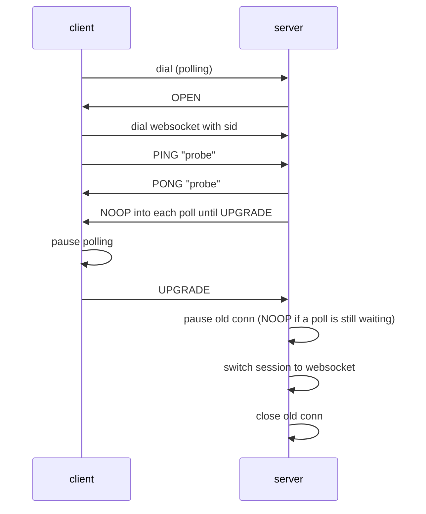

# V2 protocol implementation

These notes concern the independent `v2/` module.

## Implemented: Engine.IO protocol v4

Package `v2/engineio`, the v2 module. The root `engineio` package of the v1 module is
described in [PROTOCOL.md](PROTOCOL.md#engineio-protocol-v3).

- Query parameter `EIO` must be `4`. It is
  checked before the transport; a missing or other value is HTTP 400 with error code 5. The
  Go dialer (`engineio/client`) sends `EIO=4`, replacing any value in the URL. Its
  `Dialer.HandshakeTimeout` (default 10 s) bounds each transport tried, from the dial to the
  `OPEN` packet; an expired attempt fails with an error that wraps `os.ErrDeadlineExceeded`.
- Transports: `polling` (XHR only; the `j` JSONP parameter and the `b64` parameter are
  ignored, as in Engine.IO v4) and `websocket` (`gobwas/ws`). Order and upgrade path come from `engineio.Options.Transports`,
  default `[polling, websocket]`.
- Handshake (`OPEN` packet) carries `sid`, `upgrades`, `pingInterval` (default 20 s),
  `pingTimeout` (default 60 s) and `maxPayload`: the POST limit of the polling transport
  (`polling.Transport.MaxPayload`, default 1 MiB), the value the transport enforces. A server
  without a polling transport advertises the message limit of its websocket transport, as the
  single `maxHttpBufferSize` of the Node server bounds both. `engineio.Options.MaxPayload`,
  when positive, sets both limits of the server: a polling POST body in wire bytes and one
  websocket message in data bytes, the units of the Node server. The default is 1 MiB
  (1,048,576 bytes), where Node's `maxHttpBufferSize` is 1e6 bytes. `NewServer` applies it to
  private copies of its polling and websocket transports, so later changes to those structs
  or to `polling.Default.CheckOrigin` do not reach the server.
- Heartbeat: the server sends `PING` (`2`)
  `pingInterval` after the handshake and `pingInterval` after each `PONG` (`3`), as the Node
  server does, and closes the session with reason `ping timeout` when no `PONG` arrives within
  `pingTimeout` of a `PING`. Control packets are processed by the connection's reader, so the
  heartbeat holds only while the application keeps reading; the contract is the godoc of
  `engineio.Conn.NextReader` and [ROADMAP.md](ROADMAP.md#20-generic-api-and-lifecycle-contract)
  (2.0). The transport read and write deadlines are a backstop for operations the ping
  timeout cannot interrupt, such as a polling POST body read or a blocked write: each `PING`
  and each `PONG` moves them to `pingInterval + pingTimeout` from then, so they expire no
  earlier than `pingInterval` after the ping timeout of the outstanding `PING`, however late
  that `PING` was sent. A `PING` from the
  client is not answered: it closes the session with reason `transport error` and
  `invalid heartbeat direction`, as on the Node server. The Go client (`engineio/client`)
  sends no `PING`; its `NextReader` answers each `PING` with `PONG`, and when no `PING`
  arrives within `pingInterval + pingTimeout` of the `OPEN` packet or of the last `PING`, it
  closes the connection and `NextReader` fails with an error that starts with `ping timeout`,
  as the Node client closes.
- Polling payload: packets are
  separated by the record separator `0x1e`; binary packets are base64 behind a `b`
  prefix; every body is `text/plain; charset=UTF-8`, and a POST of `application/octet-stream`
  is HTTP 400. A POST body is read up to the transport's `MaxPayload` (default 1 MiB,
  `polling.Transport.MaxPayload`) before it is decoded: an announced or actual size over it is
  HTTP 413 and delivers nothing; a malformed body is HTTP 400, delivers nothing and ends
  the session. The server does not limit its responses: a response carries every packet the
  session writers hand over at once. The Go client reads a response (and the open
  response) up to the same `MaxPayload`; a longer one fails the session with
  `payload.ErrTooLarge`, which readers see. The client batches its POSTs up to the
  `maxPayload` of the open packet, and up to its `MaxPayload` (default 1 MiB) when the
  open packet carries none, as an older server's does. Sessions are looked up by `sid`; an unknown `sid` is HTTP 400.
- WebSocket framing: one packet per data
  message. A text message is the type byte and the data; a binary message is the raw data of
  a MESSAGE packet with no type byte, and the text form `b` + base64 is read as a binary
  MESSAGE. The server hijacks the HTTP/1.1 request (`ws.UpgradeHTTP`); a response writer
  that is not an `http.Hijacker`, as with HTTP/2, is answered with HTTP 501 and logged as
  `engineio: request rejected` with `reason="no hijacker"`. No extension is negotiated, so
  `permessage-deflate` is not supported, and no subprotocol is selected by the server. A
  message is limited to the transport's `MaxPayload` (default 1 MiB,
  `websocket.Transport.MaxPayload`), the fragments of one message together, checked before
  they are buffered. The peer is told why it is cut off with a close frame, then the TCP
  connection is half-closed, drained for at most one second and closed (a `Close` by the consumer in between marks the connection closed but leaves the socket to the drain): status 1009 for an oversized message, 1007 for invalid UTF-8 and
  1002 for a framing violation (unmasked client frame, reserved bits or opcode, a stray
  continuation) or an invalid Engine.IO packet (empty text, unknown type byte, malformed
  base64). A received close frame is answered with its status and closes the connection. Ping
  and pong control frames, also between fragments, are answered by the transport and are
  not Engine.IO packets. A handshake rejected by the origin check (`CheckOrigin`, by default
  same origin) is HTTP 403. The WebSocket `Proxy` hook supports `http` proxies through
  CONNECT only.
- Upgrade polling → websocket:

  Implemented in `session.Session.upgrading`. Polling keeps serving the session until
  `UPGRADE` arrives, as on the Node server: from the probe until `UPGRADE`, a failed upgrade
  or the close of the session, the server answers every poll with `NOOP`, at most one per
  100 ms, so the client's pending poll completes and the client can pause polling; only
  `UPGRADE` pauses polling. The Node server checks every 100 ms whether a poll is pending;
  here a `NOOP` waits for the next poll and answers it at once, the following one comes at
  least 100 ms later. After a failed upgrade a `NOOP` that was already waiting still answers
  the next poll; then the `NOOP`s stop. The probe and `UPGRADE` must both arrive within
  `engineio.Options.UpgradeTimeout` (default 10 s, the `upgradeTimeout` of the Node server)
  of the moment the server accepts the websocket connection: one timer, started then, bounds
  the probe, its answer and `UPGRADE`, and the probe does not extend it. If anything else
  follows the probe or the timer expires, the upgrade fails: the websocket connection is
  closed and the session stays on polling, which was never paused. If the
  session closes during the upgrade (for example on a ping timeout), the session ends with
  both its polling connection and the websocket connection closed, and it is not switched.

  A session upgrades at most once. The server reserves the upgrade before the websocket
  transport hijacks the request, and returns the reservation when the upgrade does not switch
  the session: a refused handshake (origin check, malformed upgrade request, no
  `http.Hijacker`), a failed probe or an expired `UpgradeTimeout`. The server returns it before
  it closes the websocket connection, except when the transport has already closed the
  connection on a read error (a peer close or a protocol violation); a client that sees the
  server close the connection of a failed upgrade may try again at once. A websocket request
  with the `sid` of a session that is upgrading, or already on websocket (upgraded, or opened
  there), is rejected before the hijack with HTTP 400 and code 3, logged as
  `engineio: request rejected` with `reason="bad upgrade"`. The Node server
  differs in both cases: while a session is upgrading or upgraded it completes the WebSocket
  handshake (101) and then closes the new connection, and it treats a second websocket of a
  session opened on websocket as an upgrade candidate (`_maybeUpgrade`). A request for a
  closed session gets code 1 instead (error table below). The server checks for a closed
  session before it takes the reservation, in a separate step, so a session that closes
  while its request is being handled may still get code 3.
- Error responses (Engine.IO v4): the server answers a rejected request with the JSON
  body `{"code":N,"message":"..."}` and content type `application/json`:

  | Code | Message | Status | Cause |
  | --- | --- | --- | --- |
  | 0 | `Transport unknown` | 400 | `transport` is not one of `Options.Transports` |
  | 1 | `Session ID unknown` | 400 | no session has the `sid`, or the session is closed but still registered and the request is one it would not serve: a websocket request, or a request on another transport than the session's (the Node server deletes a closed client) |
  | 2 | `Bad handshake method` | 400 | a handshake (no `sid`) that is neither GET nor an OPTIONS preflight |
  | 3 | `Bad request` | 400 | for an open session, a transport change it cannot make or a websocket request while it is upgrading or already on websocket; a failed session start; a polling request that is not GET, POST or OPTIONS |
  | 4 | `Forbidden` | 403 | `Options.RequestChecker` returned an error |
  | 5 | `Unsupported protocol version` | 400 | `EIO` is missing or not `4` |

  An OPTIONS request without `sid` opens no session. Only the polling transport answers it
  as a CORS preflight (HTTP 200 with the CORS headers). On the websocket transport it gets
  the WebSocket transport's rejection of a request that is not an upgrade (HTTP 405 from
  `gobwas/ws`, below) and is logged with `reason="accept"`.
  A failed transport accept (HTTP 502), a writer without `http.Hijacker` (HTTP 501), a
  rejected polling POST (HTTP 400 or 413, above) and a failed poll (HTTP 500) are plain text.
  So are the WebSocket transport's own handshake answers: HTTP 403 when `CheckOrigin` refuses
  the origin, and the answer `gobwas/ws` writes when it rejects the upgrade request, with its
  own status (for example 400 for a missing or malformed upgrade header, 405 for a method
  other than GET).
  The server logs each of its rejections, the 501 and 502 included, as
  `engineio: request rejected` with a `reason`. The polling transport logs the same record
  through `logger.Log` for a failed poll, `reason="flush"`, at DEBUG when the connection has
  closed or an earlier poll already reported the failure that ended the payload and at WARN
  otherwise (the first report of that failure, or a failure of one poll such as an
  overlapping poll), and for an invalid method, `reason="bad method"`.

## Implemented in `v2/`: Socket.IO protocol v5 wire codec

Package `v2/parser`, stage 2.3P. It converts packets to and from the wire format and has
no runtime: nothing in the `v2/` root package calls it before stage 2.3S. The wire format is
that of `socket.io-parser` 4.2.7 (protocol 5), checked against it by the Node oracle in
`v2/parser/testdata/oracle` (run by hand, see its README; CI does not run it).

- A message is one text frame, the envelope, followed by as many binary frames as the
  envelope announces. The envelope is `<type>[<attachments>-][<namespace>,][<ack id>][JSON]`.
  Types on the wire: 0 CONNECT, 1 DISCONNECT, 2 EVENT, 3 ACK, 4 CONNECT_ERROR,
  5 BINARY_EVENT, 6 BINARY_ACK. `parser.Type` holds 0 to 4 only; an EVENT or ACK with
  attachments is written as 5 or 6.
- Binary values are replaced in the JSON by `{"_placeholder":true,"num":N}` and sent as
  the following binary frames, in order.

Deliberate differences from the Node.js parser:

- Missing EVENT, ACK or CONNECT_ERROR data is rejected, although Node's decoder
  accepts an absent payload. CONNECT may omit data; DISCONNECT must omit it.
- A namespace in a header must start with `/` and end its header with a comma, and
  contains no comma, NUL, CR or LF. The default namespace is returned as `/`.
- Attachment counts are unsigned decimal digits and positive; `1.0` and `1e0` are
  rejected, and so is a count of zero, as by 4.2.7.
- An acknowledgement ID above 2^53-1 is rejected. Leading zeros are accepted and
  written canonically.
- A placeholder index must be an integer name of an attachment; a fractional index
  is rejected where Node yields an undefined attachment value.
- Envelopes must be valid UTF-8 and valid JSON of bounded depth. The attachment
  count, byte and depth limits are checked here; Node's decoder waits for missing
  attachments instead of failing, so the `Assembler` adds a deadline.
- Unreferenced attachments and repeated placeholder indices are accepted, as by
  Node; each decoded reference owns its bytes where Node shares one buffer. Because
  that multiplies memory, `JSON[T]` decoding counts every reference, repeated ones
  included, against `Limits.MaxEventBytes` and returns `ErrTooLarge` past it.
- JSON decoding replaces an unpaired UTF-16 surrogate escape in a string by U+FFFD
  when a value is decoded into a Go string; the raw `Packet.Data` keeps the escape.

## Protocol changes from v1: Engine.IO v4 and Socket.IO v5

Target of [ROADMAP.md](ROADMAP.md#stage-2-socketio-protocol-v5-over-engineio-protocol-v4-tag-v200).

Engine.IO v3 → v4 (implemented in `v2/engineio`, see above):

| Area | v3 (v1, repository root) | v4 (`v2/engineio`) |
| --- | --- | --- |
| Query | `EIO` ignored | `EIO=4` required, otherwise HTTP 400 with JSON error code 5 |
| Handshake | `sid`, `upgrades`, `pingInterval`, `pingTimeout` | plus `maxPayload` |
| Heartbeat | client sends `2`, server answers `3` | server sends `2` every `pingInterval`, client answers `3` within `pingTimeout` |
| WebSocket | one packet per frame, binary frames start with a type byte | unchanged; binary frames carry raw bytes |
| Upgrade | `2probe` / `3probe` / `5` | unchanged, plus server answers the polls with `6` (NOOP) until `5`; polling pauses on `5` |
| Errors | plain text | JSON `{"code": N, "message": "..."}`, codes 0..5 |

Socket.IO v4 → v5:

| Area | v4 (v1, repository root) | v5 (target; the wire codec is in `v2/parser`, see above) |
| --- | --- | --- |
| Root namespace | server connects `/` automatically | client must send `0`; server replies `0{"sid":"..."}` |
| Socket id | engine `sid` for `/`; `<namespace>#<engine sid>` elsewhere | separate id per (connection, namespace) |
| CONNECT payload | none | optional JSON auth object: `0/admin,{"token":"abc"}` |
| Connection error | type 4 ERROR, string | type 4 CONNECT_ERROR, object `{"message","data"}` |
| DISCONNECT | `1/nsp` | `1/nsp,` |
| Binary attachments | placeholder objects | unchanged |
| Connection state recovery | none | `pid`/`offset` in CONNECT; out of scope, answered without recovery |

Not planned: EIO=3 in v2, WebTransport, permessage-deflate, connection state recovery.
